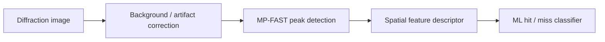

# MP-FAST on FPGA

**Hardware-accelerated Bragg-peak detection for serial X-ray crystallography using C++ and AMD/Xilinx Vitis High-Level Synthesis (HLS).**

`FPGA` · `C++` · `Vitis HLS` · `Scientific Imaging` · `Serial Crystallography`

## Overview

Modern serial crystallography experiments generate large volumes of diffraction images, many of which contain no useful crystal diffraction. Identifying Bragg peaks early in the acquisition and processing pipeline is an important step toward efficient **hit/miss classification** and data reduction.

**MP-FAST (Modified and Parallelized FAST)** adapts the FAST feature-detection concept to locate diffraction peaks in X-ray images. This repository contains an **FPGA-oriented C++ implementation** of the MP-FAST feature-extraction stage, developed with Vitis HLS. It is part of the broader research effort on machine-learning-based data reduction in serial crystallography.

> **Scope:** This repository focuses on the FPGA implementation of MP-FAST. It is **not** a standalone, end-to-end hit/miss machine-learning classifier or a turnkey detector acquisition system.

## Design goals

- **Hardware-friendly peak detection:** translate a local-neighborhood image operation into a synthesizable C++ processing kernel.
- **Streaming image access:** reuse nearby pixels through an on-chip line/ring buffer instead of repeatedly fetching an entire neighborhood from off-chip memory.
- **Pipeline-oriented processing:** organize computation and memory access to support efficient HLS scheduling.
- **Memory-interface optimization:** investigate wider memory transfers and data-movement strategies to reduce bandwidth bottlenecks.
- **Reproducible hardware development:** retain source code alongside software-emulation, hardware-emulation, and hardware build artifacts.

## MP-FAST in the crystallography pipeline

The larger research pipeline can be summarized as follows:



**This repository implements the FPGA-oriented MP-FAST stage**, rather than all the blocks shown above. The detector identifies candidate Bragg-peak locations by comparing a pixel with selected neighboring intensities and applying local-maximum logic, instead of treating the problem as generic corner detection.

## FPGA implementation

The implementation is based on **C++ High-Level Synthesis**, where the processing structure and HLS directives guide the translation into FPGA logic. The associated research describes the following design principles:

### Local-neighborhood processing with a ring buffer

MP-FAST needs access to neighboring pixels for each candidate location. A **four-line on-chip ring buffer** provides the necessary local context while the next image line is loaded. This reduces redundant off-chip reads and makes the image traversal suitable for a streaming datapath.

### Pipelining and memory movement

The accelerator is organized around the HLS **load–compute–store** pattern: image data are transferred to the processing kernel, local neighborhoods are evaluated, and results are written back. Fixed-bound loops and HLS directives help expose loop-level parallelism and control memory access. The historical `mp_fast_v6` development also includes changes aimed at **port widening** and a revised **ring-buffer** approach.

### Target platform

The associated published FPGA study used an **AMD/Xilinx Alveo U280** accelerator and Vitis-based HLS development. Compatibility of this extracted code with a particular Vitis release, platform file, or FPGA board should be verified before rebuilding.

## Repository structure

```text
MP-FAST-FPGA/
├── src/             # C++ / HLS source code
├── sw_emulation/    # Software-emulation artifacts
├── hw_emulation/    # Hardware-emulation artifacts
└── Hardware/        # Hardware build artifacts
```

The repository was extracted from the `VitisWS/mp_fast_v6` subproject in the original Vitis workspace. Its Git history preserves the relevant development commits from March 2023.

## Working with the project

### Prerequisites

To rebuild or reproduce the FPGA development workflow, you will typically need:

- A compatible **AMD/Xilinx Vitis / Vitis HLS** toolchain
- The correct **FPGA platform definition** and, for hardware execution, the associated drivers/runtime
- A supported FPGA development or accelerator board for on-device execution

### Suggested workflow

1. Inspect the kernel and host-side sources under `src/`.
2. Import or configure the project in the matching Vitis environment.
3. Run **software emulation** to check functional behavior.
4. Run **hardware emulation** to inspect the synthesized execution path.
5. Build for the target hardware only after selecting the appropriate platform and toolchain versions.

> **Reproducibility note:** This is an archived research implementation, not a packaged cross-platform application. Exact build commands and platform dependencies depend on the original Vitis environment; no universal one-command build is claimed here. The presence of emulation folders does not, on its own, establish that a fresh build has been verified.

## Research context and publication

This FPGA work is described in the following peer-reviewed publication, which covers MP-FAST, the image descriptor, the classification pipeline, and CPU/GPU/FPGA implementations:

**Rahmani, V., Nawaz, S., Pennicard, D. & Graafsma, H. (2024).** *Robust image descriptor for machine learning based data reduction in serial crystallography.* **Journal of Applied Crystallography, 57**, 413–430.  
https://doi.org/10.1107/S160057672400147X

```bibtex
@article{rahmani2024robust,
  title   = {Robust image descriptor for machine learning based data reduction in serial crystallography},
  author  = {Rahmani, Vahid and Nawaz, Shah and Pennicard, David and Graafsma, Heinz},
  journal = {Journal of Applied Crystallography},
  volume  = {57},
  pages   = {413--430},
  year    = {2024},
  doi     = {10.1107/S160057672400147X}
}
```

## Project status and reuse

This repository is maintained as a **research-code archive** demonstrating FPGA-oriented scientific image-processing techniques. It is provided for inspection and technical discussion; its current publication does not imply that it has been recently rebuilt, tested against every Vitis release, or validated on other accelerator cards.

**Licensing:** This project is licensed under the MIT License. See LICENSE for details.

---

*Developed in the context of research on real-time X-ray diffraction data reduction at DESY.*
